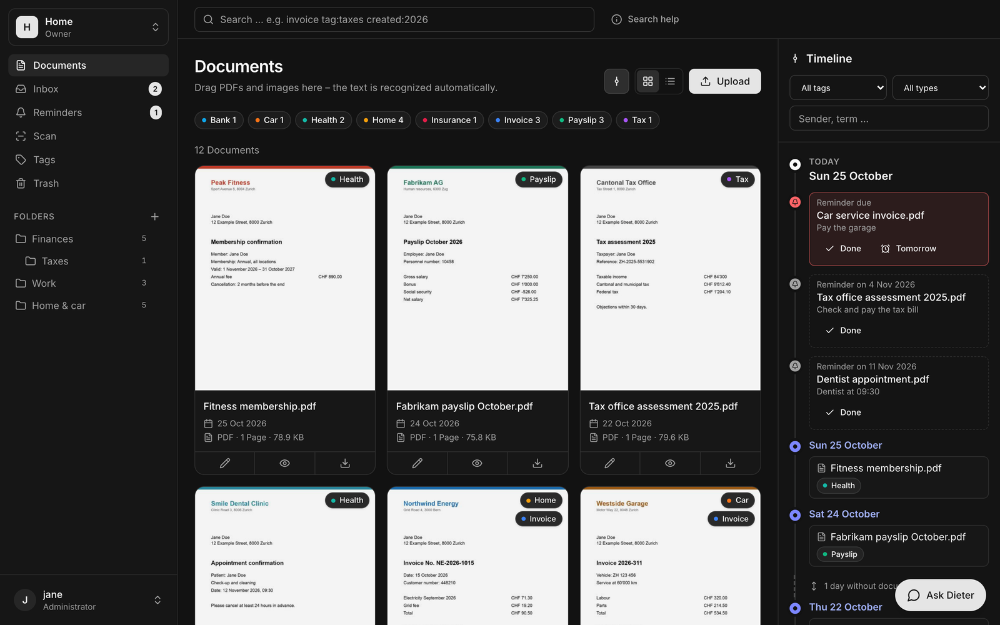
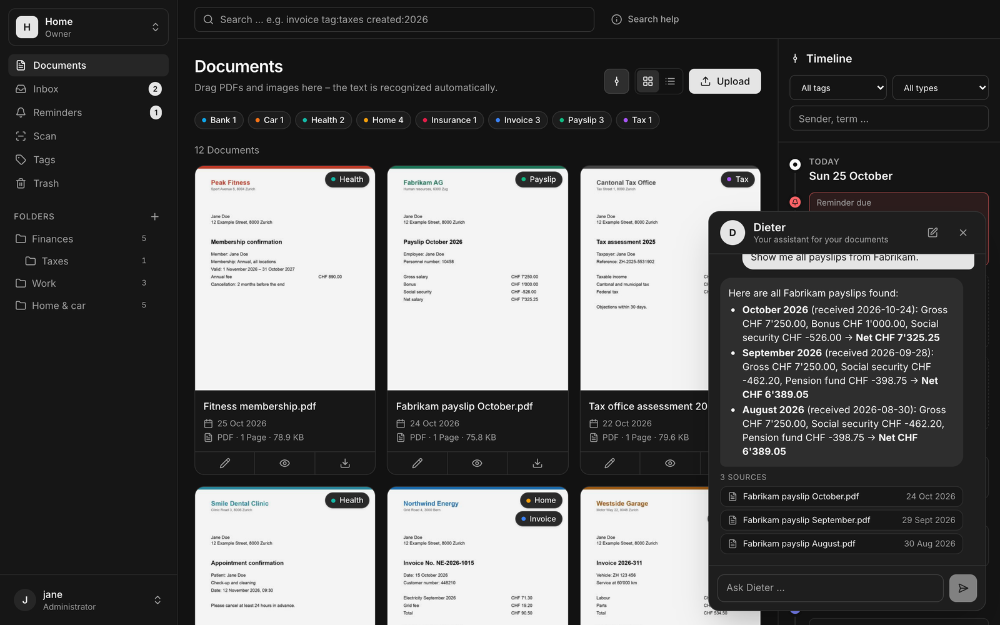
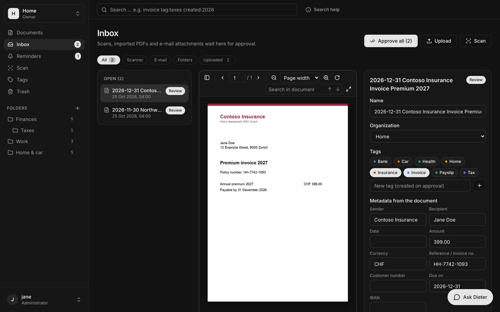
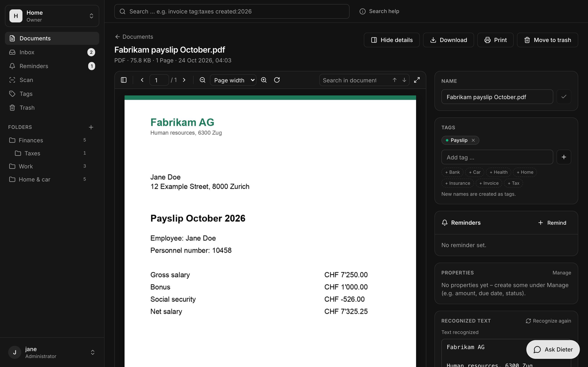
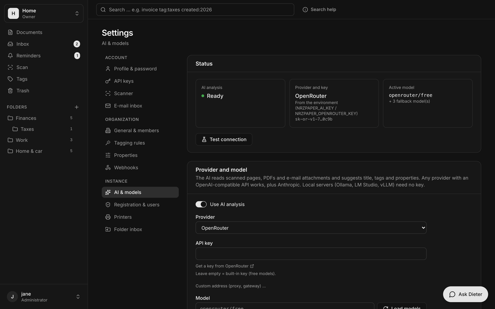
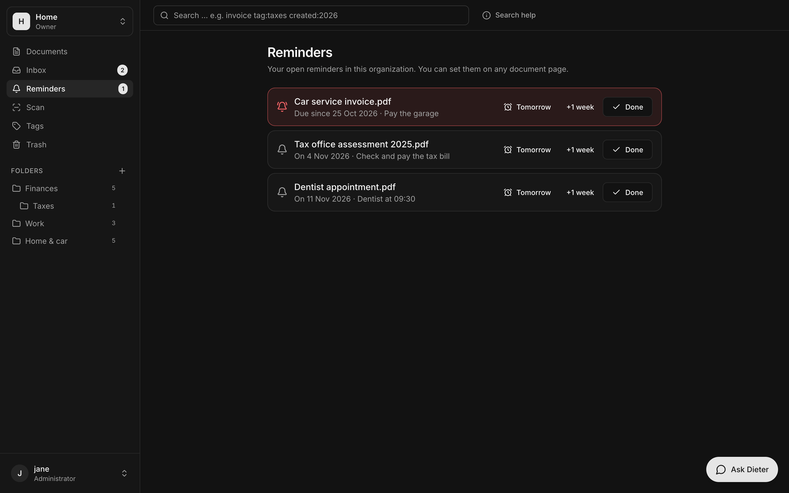
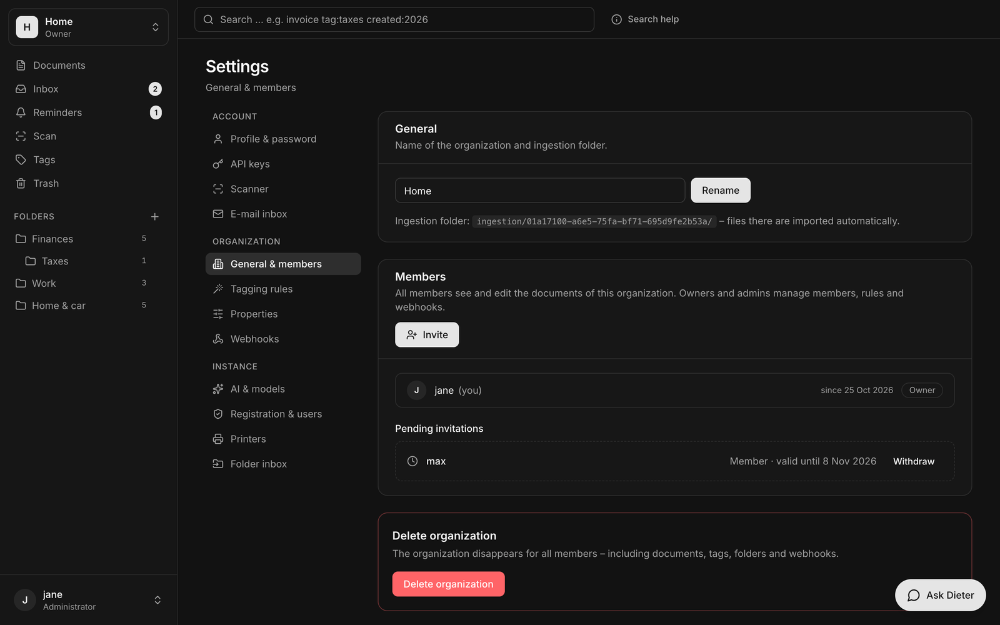

<!--
Übersetzungsvorlage für Svenska (Swedish).
Bitte den Inhalt unten in die jeweilige Sprache übersetzen.
-->

<div align="center">


# nrzPaper

**Selbst gehostete Dokumentenverwaltung in Rust: Papierkram scannen, erkennen, taggen und finden – verschlüsselt in einer Datei.**

[English](../README.md) · [Français](README.fr.md) · [Italiano](README.it.md) · [Español](README.es.md) · [Português](README.pt.md) · [Nederlands](README.nl.md)



</div>

nrzPaper ist ein einziges Programm ohne externe Datenbank. Alles liegt in einer SQLCipher-verschlüsselten SQLite-Datei, auch die Dateien selbst. Es erkennt Text mit Tesseract, scannt direkt von Netzwerkscannern, holt E-Mail-Anhänge ab und lässt eine KI deiner Wahl Titel, Tags und Metadaten vorschlagen. **Dieter**, der eingebaute Assistent, beantwortet Fragen zu deinen Dokumenten und verlinkt die Quellen. Die Oberfläche ist eine Rust/WebAssembly-App (Dioxus) in ruhigem Dunkelgrau und funktioniert auch am Handy.

## Funktionen

| | |
|---|---|
| **Erfassen** | Drag & Drop, Upload, **Netzwerkscanner** (eSCL/AirScan: Canon, HP, Epson, Brother …), **E-Mail-Postfächer** (IMAP, mehrere Konten), **überwachte Ordner** (z. B. der Scan-Ordner auf dem NAS), REST-API |
| **Inbox** | Scans, Mails, Ordner-Importe und Uploads warten auf die Abnahme: Die KI schlägt Name, Tags und Felder vor, du gibst einzeln oder **alle auf einmal** frei. Filter nach Quelle (Scanner, jedes Postfach, jeder Ordner, Upload). |
| **Erkennen** | Tesseract und Poppler im Hintergrund, auch für gescannte PDFs und Fotos. Volltextsuche mit Wortanfängen, Wortfolgen und Filtern (`tag:`, `-tag:`, `type:`, `created:>2026-06-01`, …) |
| **Ordnen** | Farbige Tags, **Ordner aus Tags** (verschachtelt), **Tagging-Regeln** („enthält Northwind → Rechnung“), eigene **Eigenschaften** (Text, Zahl, Datum, Ja/Nein, Auswahl, Mehrfachauswahl, Benutzer, Verweis auf ein Dokument) |
| **Zeitleiste** | Senkrechte Zeitleiste neben den Dokumenten: oben heute, darunter jeder Tag mit Post und die Lücken dazwischen („12 Tage ohne Dokumente“). Filter nach Tag, Art und Text. |
| **Erinnerungen** | „Erinnere mich in 10 Tagen“ an jedem Dokument, mit Notiz. Fällige Erinnerungen stehen in der Seitenleiste und oben in der Zeitleiste. |
| **Drucken** | Auf jedem **IPP-Netzwerkdrucker** (AirPrint, IPP Everywhere, Mopria, CUPS), den der Server findet. PDFs gehen direkt, an Drucker, die nur JPEG annehmen, als Seitenbilder. |
| **KI, jeder Anbieter** | OpenRouter (kostenlose Modelle eingebaut), OpenAI, Anthropic, Google Gemini, Mistral, Groq, xAI, DeepSeek, Together, Fireworks, Perplexity, Cohere, NVIDIA, Hugging Face, Qwen, Azure OpenAI, **Ollama, LM Studio, vLLM/LocalAI** oder jede OpenAI-kompatible Adresse. Modelle ohne Bildeingang bekommen den erkannten Text. |
| **Dieter** | Chat-Assistent unten rechts: *„Wie lautet meine Versicherungsnummer?“*, *„Alle Lohnabrechnungen von Fabrikam 2026“*. Er sucht, liest die passenden Stellen und antwortet mit Links zu den Dokumenten. |
| **Teams** | Mehrere Organisationen, **mehrere Konten je Organisation** (Einladungen, Rollen Besitzer/Admin/Mitglied, Besitz übergeben), API-Keys mit Rechten, Webhooks (Standard-Webhooks-Signatur), öffentliche Freigabelinks |
| **Sprachen** | Deutsch, English, Français, Italiano, Español, Português, Nederlands (weitere über `locales/<code>.json`) |
| **Sicher** | Eine verschlüsselte Datei, Argon2-Passwörter, CSP ohne Inline-Skripte, CSRF-Schutz, Dateien nur über die API |

## Bilder

| | |
|---|---|
|  |  |
| **Dieter** antwortet mit Quellen | **Inbox**: prüfen und freigeben, nach Quelle filtern |
|  |  |
| **Dokument**: PDF-Ansicht, Tags, Erinnerungen, Drucken | **KI & Modelle**: jeder Anbieter, lokal oder Cloud |
|  |  |
| **Erinnerungen** | **Mitglieder** und Einladungen |

## Schnellstart

Du brauchst Docker. Das Image enthält Programm, Oberfläche, Tesseract (Deutsch, Englisch) und Poppler.

```bash
git clone https://github.com/nicorenezweers/nrzPaper.git
cd nrzPaper
docker build -t nrzpaper .
docker run -d --name nrzpaper -p 8320:8320 -v nrzpaper-data:/data nrzpaper
```

<http://localhost:8320> öffnen. Das erste Konto wird Administrator. Danach ist die Registrierung zu, bis du sie unter *Einstellungen → Registrierung & Benutzer* öffnest. Dort legst du auch Konten für andere an.

### Docker Compose

```yaml
services:
  nrzpaper:
    build: .                      # oder: image: ghcr.io/nicorenezweers/nrzpaper:1.0.0
    container_name: nrzpaper
    restart: unless-stopped
    ports:
      - "8320:8320"
    volumes:
      - nrzpaper-data:/data       # verschlüsselte Datenbank + Schlüsseldatei
      - /srv/scans:/scans         # optional: Ordner für den Ordner-Eingang
    environment:
      TZ: Europe/Zurich
      # NRZPAPER_DB_KEY: "ein-langes-geheimnis"   # sonst wird /data/nrzpaper.key erzeugt
      # NRZPAPER_COOKIE_SECURE: "true"            # hinter HTTPS
      # NRZPAPER_AI_PROVIDER: "openai"            # oder in der Oberfläche einstellen
      # NRZPAPER_AI_KEY: "sk-…"

volumes:
  nrzpaper-data:
```

```bash
docker compose up -d
```

> **Sichere `/data`.** Dort liegen `nrzpaper.db` (alles, verschlüsselt) und `nrzpaper.key`. Ohne den Schlüssel lässt sich die Datenbank nicht öffnen. Wenn du `NRZPAPER_DB_KEY` setzt, bewahre stattdessen diesen Wert gut auf.

### Beide Architekturen

```bash
docker buildx build --platform linux/amd64,linux/arm64 -t <registry>/nrzpaper:1.0.0 --push .
```

## Erste Schritte

1. **Hochladen**: ein paar PDFs oder Fotos. Der Text wird im Hintergrund erkannt.
2. **Tags** anlegen (z. B. *Rechnung*, *Versicherung*) und beschreiben. Die KI vergibt sie anhand der Beschreibung.
3. **KI** (*Einstellungen → KI & Modelle*): Anbieter wählen, Schlüssel eintragen (oder die eingebauten kostenlosen OpenRouter-Modelle bzw. ein lokales Ollama nutzen), *Modelle laden*, *Verbindung testen*.
4. **Scanner** (*Profil → Scanner*): *Scanner im Netz suchen* findet eSCL/AirScan-Geräte, dann *Scannen* in der Seitenleiste.
5. **E-Mail** (*Profil → E-Mail-Eingang*): ein oder mehrere IMAP-Postfächer. PDFs und Bilder aus Anhängen landen in der Inbox.
6. **Ordner-Eingang** (*Einstellungen → Ordner-Eingang*, Admins): einen Server-Ordner wie `/scans` überwachen (vorher in den Container einbinden).
7. **Drucker** (*Einstellungen → Drucker*, Admins): *Im Netz suchen* oder `ipp://drucker/ipp/print` eintragen. Danach druckt jedes Mitglied von der Dokumentseite aus.

## Einstellungen

Jede Einstellung geht als Umgebungsvariable mit dem Präfix `NRZPAPER_` (oder in `Rocket.toml`).

| Variable | Vorgabe | Bedeutung |
|---|---|---|
| `NRZPAPER_DATA_DIR` | `/data` (Image) | Datenbank, Schlüsseldatei, Eingangsordner |
| `NRZPAPER_DB_KEY` | – | Datenbankschlüssel. Fehlt er, wird `nrzpaper.key` im Datenordner erzeugt |
| `NRZPAPER_PORT` / `NRZPAPER_ADDRESS` | `8320` / `0.0.0.0` | Wo der Server lauscht |
| `NRZPAPER_COOKIE_SECURE` | `false` | Hinter HTTPS auf `true` |
| `NRZPAPER_REGISTRATION_OPEN` | `false` | Selbst registrieren erlauben (auch in der Oberfläche umschaltbar) |
| `NRZPAPER_OCR_LANGUAGES` | `deu+eng` | Tesseract-Sprachen (das Image bringt `deu` und `eng` mit) |
| `NRZPAPER_OCR_WORKERS` | `2` | Gleichzeitige Texterkennungen |
| `NRZPAPER_TRASH_RETENTION_DAYS` | `30` | Tage im Papierkorb |
| `NRZPAPER_INBOX_KEEP_DAYS` | `7` | So lange bleiben nicht freigegebene Inbox-Einträge |
| `NRZPAPER_SCANNER_URL` | – | Voreingestellter Scanner für neue Konten, z. B. `http://192.168.1.50` |
| `NRZPAPER_SCAN_SUBNETS` | `192.168.0.0/24,192.168.1.0/24` | Netze für die Scanner- und Druckersuche |
| `NRZPAPER_AI_PROVIDER` | `openrouter` | `openai`, `anthropic`, `gemini`, `mistral`, `groq`, `ollama`, `custom`, … |
| `NRZPAPER_AI_KEY` / `_URL` / `_MODEL` | – | Schlüssel, Adresse und Modell für diesen Anbieter |
| `NRZPAPER_OPENROUTER_KEY` | – | OpenRouter-Schlüssel (Alternative zu oben) |
| `NRZPAPER_LOG` | `info` | Protokoll, z. B. `debug` |

Was in der Oberfläche eingestellt wird (KI-Anbieter, Schlüssel, Modelle, Registrierung), liegt verschlüsselt in der Datenbank und hat Vorrang vor der Umgebung.

### KI-Anbieter

| Anbieter | Adresse | Hinweis |
|---|---|---|
| OpenRouter | eingebaut | Kostenlose Bild-Modelle, eigener Schlüssel optional |
| OpenAI, Anthropic, Google Gemini, Mistral, Groq, xAI, DeepSeek, Together, Fireworks, Perplexity, Cohere, NVIDIA, Hugging Face, Qwen | eingebaut | API-Schlüssel des Anbieters |
| Azure OpenAI | `https://NAME.openai.azure.com/openai/v1` | Modell = Name der Bereitstellung |
| Ollama / LM Studio / vLLM / LocalAI | `http://host:11434/v1` usw. | Kein Schlüssel nötig |
| Alles OpenAI-Kompatible | eigene Adresse | Schlüssel optional |

Modelle ohne Bildeingang: *„Modell liest keine Bilder – erkannten Text schicken“* anhaken. Anbieter ohne PDF-Eingang bekommen automatisch die ersten Seiten als Bilder. Die Sprache von Titel und Zusammenfassung stellst du unter *Sprache der Vorschläge* ein.

## REST-API

API-Key unter *Profil → API-Keys* anlegen (Rechte wählen). Alles liegt unter `/api/v1` mit `Authorization: Bearer np_…`.

```bash
TOKEN=np_dein_key
BASE=http://localhost:8320/api/v1

curl -H "Authorization: Bearer $TOKEN" $BASE/organizations                     # Organisationen
curl -H "Authorization: Bearer $TOKEN" -F file=@rechnung.pdf \
     $BASE/organizations/$ORG/documents                                          # hochladen
curl -H "Authorization: Bearer $TOKEN" -G $BASE/organizations/$ORG/documents \
     --data-urlencode 'searchQuery=northwind tag:rechnung created:2026'          # suchen
curl -H "Authorization: Bearer $TOKEN" -o datei.pdf \
     "$BASE/organizations/$ORG/documents/$DOC/file?download=true"                 # herunterladen
curl -H "Authorization: Bearer $TOKEN" -H "Content-Type: application/json" \
     -d '{"tagId":"'$TAG'"}' $BASE/organizations/$ORG/documents/$DOC/tags        # Tag setzen
curl -H "Authorization: Bearer $TOKEN" -H "Content-Type: application/json" \
     -d '{"expiresInDays":7}' $BASE/organizations/$ORG/documents/$DOC/share-links # Freigabelink
curl $BASE/health                                                                 # Zustand
```

Webhooks (*Einstellungen → Webhooks*) schicken signiertes JSON (`webhook-id`, `webhook-timestamp`, `webhook-signature`) für `document:created`, `document:updated`, `document:deleted`, `document:restored`, `document:tag:added` und `document:tag:removed`.

Der Eingangsordner `data/ingestion/<Organisations-ID>/` übernimmt Dateien direkt als Dokumente. Überwachte Ordner (*Ordner-Eingang*) legen sie zuerst zur Prüfung in die Inbox.

## Entwicklung

```bash
cargo run                         # Server, http://localhost:8320
cargo test

rustup target add wasm32-unknown-unknown
cargo install dioxus-cli --version 0.7.10 --locked
cd ui && dx serve                 # Oberfläche mit Hot Reload, http://localhost:8080

scripts/ui.sh && cargo build --release   # Oberfläche ins Programm einbetten
```

Übersetzungen liegen in `locales/<sprache>.json` (deutscher Text → Übersetzung). `scripts/i18n_extract.py` erneuert `locales/strings.json` und zeigt, was je Sprache fehlt. Aufbau: [ARCHITECTURE.md](../ARCHITECTURE.md).

## Lizenz

AGPL-3.0-or-later. Oberflächen-Bausteine nach [rust-ui](https://github.com/rust-ui/ui) (MIT), PDF-Ansicht mit [PDF.js](https://mozilla.github.io/pdf.js/) (Apache-2.0), Schrift [Inter](https://rsms.me/inter/) (OFL).
